<div align="center">

# 🚗 Car Maintenance Tracker

**Aplicación web para llevar el mantenimiento de tus coches: qué se hizo en cada visita al taller y qué toca hacer después.**


[**🌐 Ver la aplicación en producción**](https://TU-APP.onrender.com) · [Casos de uso](#-casos-de-uso) · [Modelo de datos](#-modelo-de-datos) · [Arquitectura](#-arquitectura-y-despliegue)

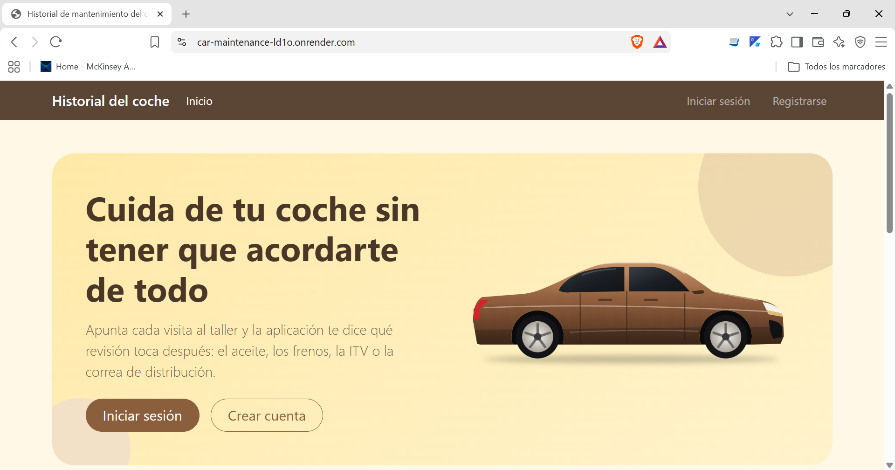

</div>

> ⏳ La aplicación está en un plan gratuito: si lleva un rato sin usarse, la primera carga puede tardar alrededor de un minuto en despertar.

---

## 📖 Sobre el proyecto

Muchos conductores llevan el mantenimiento del coche en facturas sueltas, en la memoria o en un cuaderno, y se enteran de que toca cambiar el aceite cuando ya es tarde. **Car Maintenance Tracker** centraliza todo en un único sitio:

- Cada usuario tiene su **cuenta privada** y sus propios vehículos.
- Cada visita al taller se **registra** con fecha, kilometraje, coste, descripción y la **factura adjunta** (PDF o foto).
- La aplicación **calcula automáticamente el próximo mantenimiento** de cada tipo (aceite, frenos, neumáticos, correa, ITV, revisión) y avisa de cuándo toca.
- Al terminar de hacerlo, se marca como hecho con un clic y pasa al historial.

Es un proyecto personal construido por fases, de un monolito a, en el futuro, una arquitectura de servicios. Esta es la **Fase 2: monolito con autenticación**, desplegado en producción.

---

## ✨ Funcionalidades

| | |
|---|---|
| 🔐 **Cuentas de usuario** | Registro, inicio y cierre de sesión. Cada usuario ve únicamente sus datos. |
| ✉️ **Correo de bienvenida** | Se envía al registrarse, en segundo plano, sin retrasar ni romper el alta. |
| 🚗 **Vehículos** | Alta de vehículos con marca, modelo, matrícula, kilometraje y fecha de compra. |
| 🔧 **Historial de intervenciones** | Registro de cada visita al taller. Se consulta y se edita haciendo clic en la fila. |
| 📎 **Facturas adjuntas** | PDF o foto (JPEG, PNG, WebP): hasta 5 archivos de 5 MB por visita, validados por su contenido real. |
| ⏰ **Próximos mantenimientos** | Se generan solos al registrar una visita, según el tipo, y se marcan como hechos con un clic. |
| ⭐ **Talleres y taller de confianza** | Cada usuario gestiona sus talleres y marca uno como favorito, que se propone por defecto. |
| 📱 **Diseño adaptable** | Interfaz con Bootstrap, con una paleta de tonos amarillos y marrones. |

### Cómo se calculan los próximos mantenimientos

| Tipo | Se repite cada |
|---|---|
| Cambio de aceite | 10.000 km |
| Frenos | 30.000 km |
| Neumáticos | 40.000 km |
| Correa de distribución | 90.000 km |
| ITV | 12 meses |
| Revisión | 12 meses |

<p align="center">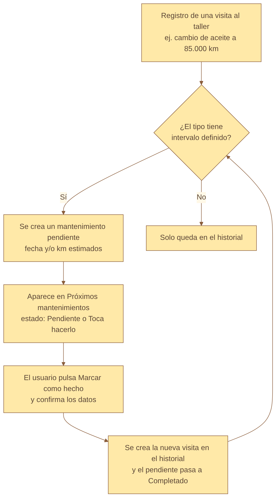</p>

---

## 📸 Capturas

<table>
  <tr>
    <td align="center">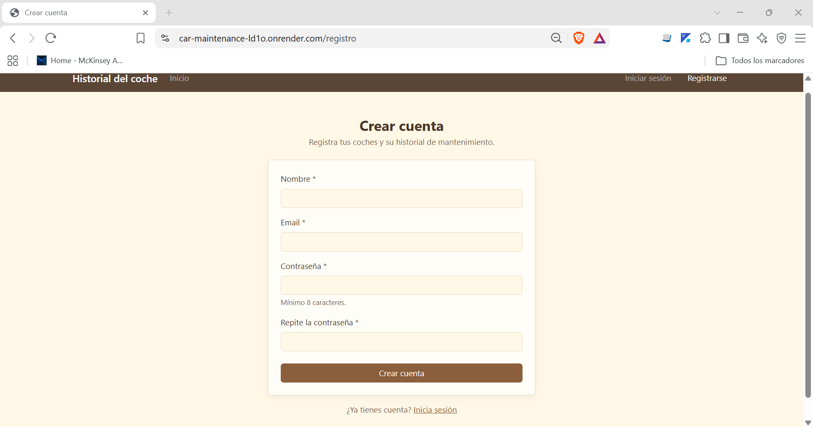<br><sub><b>Registro de usuarios</b></sub></td>
    <td align="center">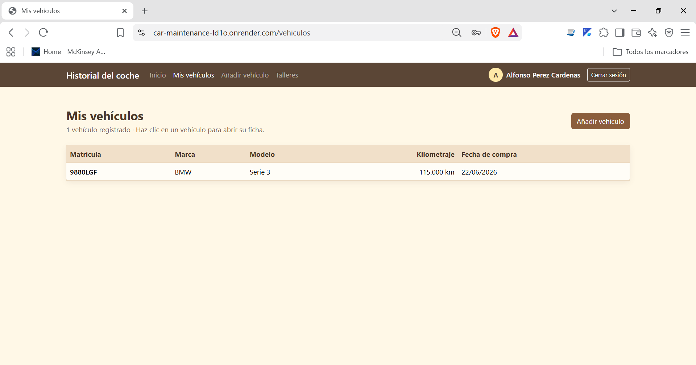<br><sub><b>Mis vehículos</b></sub></td>
  </tr>
  <tr>
    <td align="center">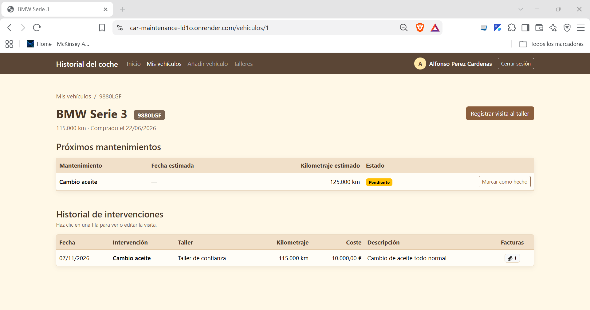<br><sub><b>Ficha: próximos mantenimientos e historial</b></sub></td>
    <td align="center">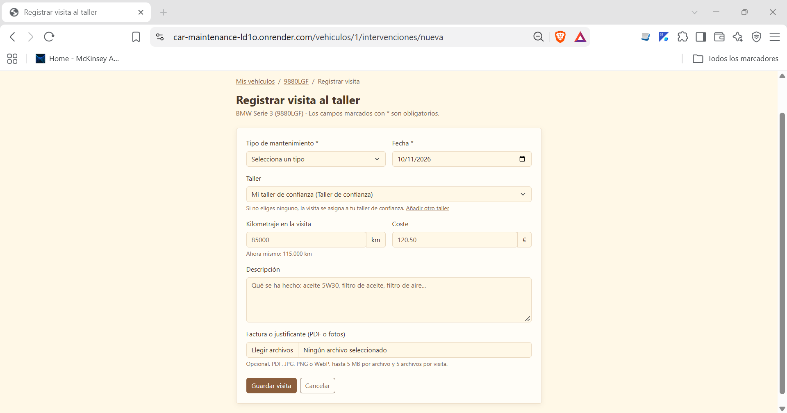<br><sub><b>Registrar visita con factura adjunta</b></sub></td>
  </tr>
  <tr>
    <td align="center">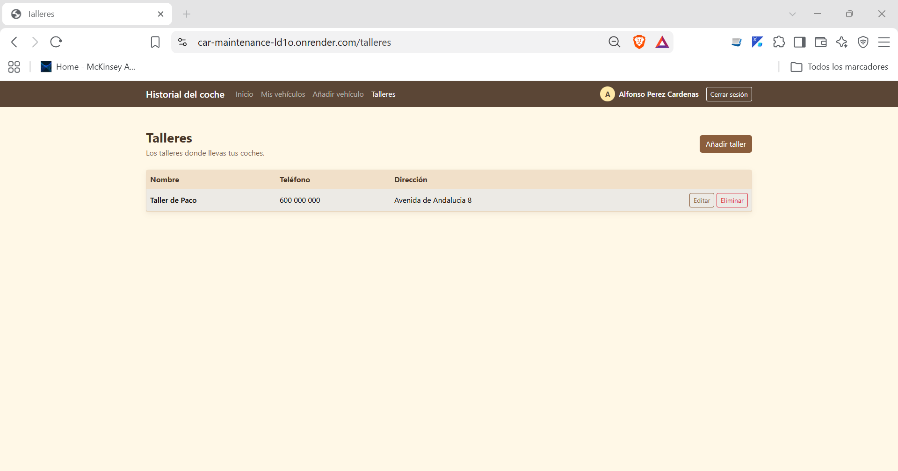<br><sub><b>Talleres y taller de confianza</b></sub></td>
    <td align="center">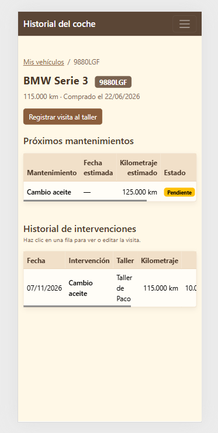<br><sub><b>Vista en móvil</b></sub></td>
  </tr>
</table>

---

## 🎯 Casos de uso

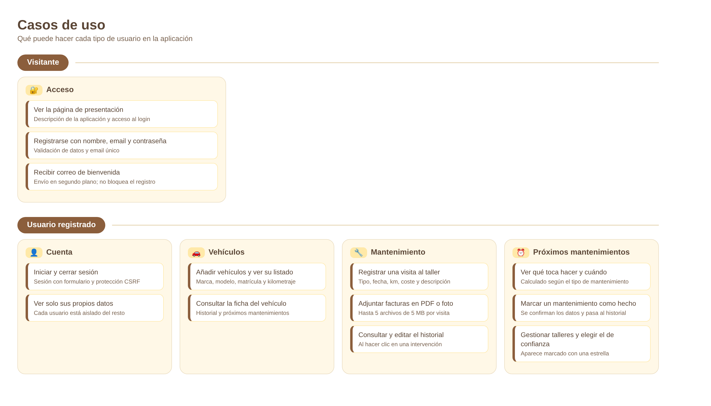

**Ejemplo de uso:** Ana registra su Seat León, anota el cambio de aceite que acaba de hacer a 85.000 km y adjunta la factura en PDF. La aplicación crea el pendiente "Cambio de aceite a los 95.000 km". Cuando llega el momento, Ana lo ve marcado como *Toca hacerlo*, lo marca como hecho tras la visita y el ciclo vuelve a empezar.

---

## 🗄️ Modelo de datos

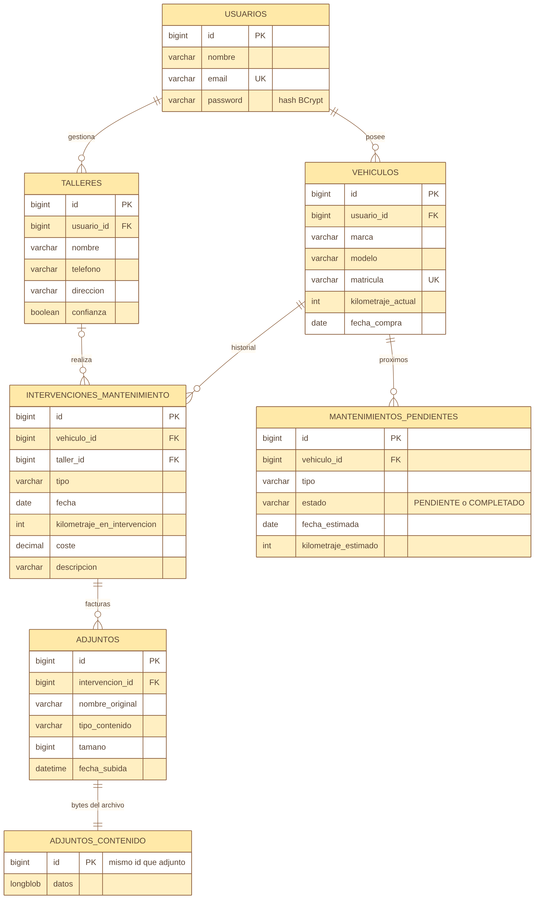

Decisiones de diseño:

- **Aislamiento por usuario:** vehículos y talleres pertenecen a un usuario. Todas las consultas comprueban la propiedad, y un dato ajeno devuelve *404*, no *403*, para no revelar que existe.
- **Facturas en dos tablas:** `adjuntos` guarda los metadatos y `adjuntos_contenido` los bytes (`LONGBLOB`). Así, listar los adjuntos no carga en memoria el contenido de todos los archivos.
- **Un taller de confianza por usuario**, creado automáticamente al registrarse.
- **Esquema gestionado por Hibernate** (`ddl-auto=update`).

---

## 🏗️ Arquitectura y despliegue

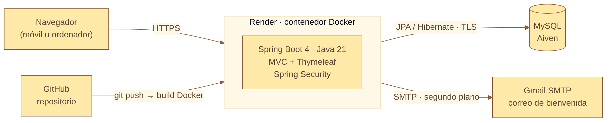

- **Aplicación monolítica** con renderizado en servidor (Spring MVC + Thymeleaf), en capas: `controller` → `service` → `repository` → `model`.
- **Despliegue en Render** como contenedor Docker, con construcción multi-etapa (Maven → JRE 21). Cada `git push` a `main` redespliega.
- **Base de datos MySQL gestionada en Aiven**, con conexión cifrada (TLS).
- **Configuración por perfiles y variables de entorno**: ningún secreto está en el repositorio.

### Seguridad

- Contraseñas con **BCrypt**; nunca se guardan en claro.
- **Protección CSRF** en todos los formularios y cookies de sesión `HttpOnly` y `Secure` en producción.
- Validación de entrada con **Bean Validation**, y **DTOs** para formularios, con campos protegidos contra *mass assignment*.
- Los adjuntos se validan por su **firma real** (magic bytes), no por la extensión que declare el usuario.
- Errores controlados con páginas propias, sin exponer trazas.

---

## 🛠️ Tecnologías

| Capa | Tecnología |
|---|---|
| Lenguaje | Java 21 |
| Framework | Spring Boot 4, Spring MVC, Spring Data JPA (Hibernate) |
| Seguridad | Spring Security 7 |
| Vistas | Thymeleaf, Bootstrap 5, JavaScript |
| Base de datos | MySQL (Aiven) |
| Correo | Spring Mail (SMTP), envío asíncrono (`@Async`) |
| Build y despliegue | Maven, Docker, Render, GitHub |

---

## 🚀 Ejecutarlo en local

**Requisitos:** Java 21, Maven y MySQL.

```bash
# 1. Clonar
git clone https://github.com/TU_USUARIO/TU_REPO.git
cd TU_REPO

# 2. Crear la base de datos
mysql -u root -p -e "CREATE DATABASE car_maintenance CHARACTER SET utf8mb4;"

# 3. Configurar credenciales
cp application-local.properties.example src/main/resources/application-local.properties
#    (edita el fichero con tu usuario y contraseña de MySQL y, si quieres, tu correo SMTP)

# 4. Arrancar
mvn spring-boot:run
```

Abre http://localhost:8080 y crea una cuenta.

> `application-local.properties` está en el `.gitignore`: tus credenciales no se suben al repositorio.

### Variables de entorno en producción

| Variable | Descripción |
|---|---|
| `DB_URL`, `DB_USER`, `DB_PASSWORD` | Conexión a MySQL |
| `APP_URL` | URL pública de la aplicación (se usa en el correo) |
| `MAIL_USUARIO`, `MAIL_CLAVE` | Cuenta SMTP para el correo de bienvenida |

Si el correo no está configurado, la aplicación funciona igual y simplemente no envía mensajes.

### Reiniciar la base de datos

`reset_base_datos.sql` borra todas las tablas (¡destructivo!). Al volver a arrancar, Hibernate las recrea vacías.

---

## 📂 Estructura del proyecto

```
src/main/java/com/monolito/historial/
├── config/        Seguridad, @Async, atributos globales
├── controller/    Auth, Vehiculo, Intervencion, Pendiente, Taller, Adjunto
├── dto/           Formularios y validación de entrada
├── exception/     Manejo centralizado de errores
├── model/         Entidades JPA
├── repository/    Spring Data JPA
├── security/      UserDetails, handlers de login y logout
├── service/       Lógica de negocio, adjuntos, correo
└── util/          Utilidades
src/main/resources/
├── templates/     Vistas Thymeleaf (auth, vehículos, talleres, email...)
└── static/        CSS e imágenes
```

## 💡 Lo que aprendí

- Diseñar un monolito en capas y securizarlo de forma correcta: aislamiento de datos entre usuarios, CSRF, validación y subida segura de archivos.
- Desplegar una aplicación Java real: contenedor Docker multi-etapa, perfiles de Spring, secretos por variables de entorno y una base de datos gestionada con TLS.
- Depurar problemas reales de producción: codificación de ficheros en el build, columnas `BLOB` que Hibernate creaba demasiado pequeñas, sesiones y cookies detrás de un proxy HTTPS.

---

<div align="center">

**Alfonso** · [LinkedIn](https://www.linkedin.com/in/alfonso-p%C3%A9rez-c%C3%A1rdenas/) · [GitHub](https://github.com/ALPHON01)

</div>